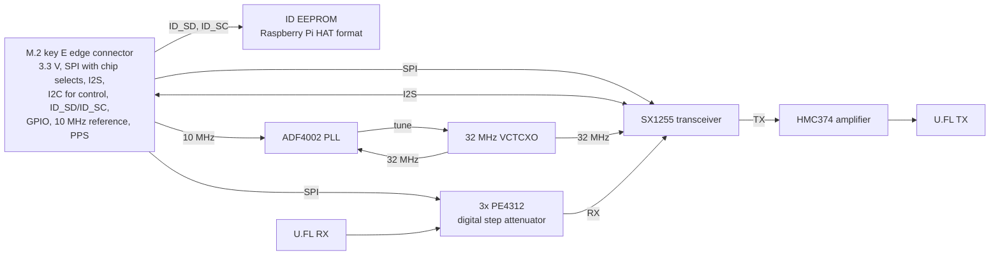

# RRU2 RF SX1255

This is an M.2 RF card for the M17 Remote Radio Unit v2 (RRU v2). The card
has the Semtech SX1255 transceiver for the 400 MHz to 510 MHz band. You can
replace the card with a card for a different band or a different chip. The
mainboard with the Raspberry Pi CM4 or CM5 stays the same. You can also use
the card without the RRU.

Revision A.

## Status

Work in progress. Not tested. Do not order.

## Block diagram

This diagram is preliminary. It can change.



The card has no other RF connectors. The M.2 connector has only power and
digital signals. The RF signals go through the two U.FL connectors.

## Key facts

| Item | Value |
|---|---|
| Form factor | M.2 key E, size 2230 or 2242 (not decided) |
| Board | 0.8 mm, 4 layers, JLCPCB stackup JLC04081H-7628 |
| RF connectors | 2x U.FL (TX and RX) |
| Frequency range | 400 MHz to 510 MHz (SX1255) |

## Repository

This is a KiCad 10 project. The KiCad library is the git submodule `lib`. It is
the [M17 KiCad library](https://github.com/M17-Project/M17_kicad_library).
The [library README](https://github.com/M17-Project/M17_kicad_library#readme)
tells how to add parts.

### Get the files

Clone the repository with the library submodule:

```sh
git clone --recursive https://github.com/M17-Project/rru2-rf-sx1255.git
```

If you cloned without `--recursive`, get the library:

```sh
git submodule update --init
```

### Build

Install KiCad 10 and KiKit. Then run:

```sh
make
```

The build checks the design first. Any ERC or DRC violation stops the build.
Each part on the BOM must have a Mouser number or a source. The outputs are in `build/`.

To use the same tools as the CI, run the build in Docker:

```sh
make docker
```

To run only the checks, run:

```sh
make check
```

This target runs the ERC, the DRC with the schematic parity check, and the BOM
check. Any violation is an error.

### Update the library

```sh
make lib-update
```

Then open the project in KiCad and update the symbols and footprints.
Commit the `lib` submodule change together with the design change.

## License

This work is licensed under a
[Creative Commons Attribution-NonCommercial-ShareAlike 4.0 International License][cc-by-nc-sa].
Refer to `LICENSE.txt`.

[![CC BY-NC-SA 4.0][cc-by-nc-sa-image]][cc-by-nc-sa]

[cc-by-nc-sa]: http://creativecommons.org/licenses/by-nc-sa/4.0/
[cc-by-nc-sa-image]: https://licensebuttons.net/l/by-nc-sa/4.0/88x31.png
